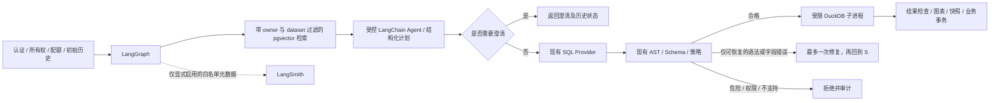

# AI 工作流升级记录

本次在 `codex/agent-rag-upgrade` 本地分支渐进升级，不自动 push、部署或调用付费服务。原始基线为 `a7971cb`，工作树干净。历史验收不能替代本次回归。

## 阶段 1：基线与兼容性

- Python 3.12.14、Node 24.15.0、npm 11.12.1。升级前真实 PostgreSQL 回归 231 passed / 1 skipped；跳过的是需显式启用的真实模型测试。Ruff check / format、Alembic check 通过。当前提交的 Actions `39378633661` 先前已成功，但本次仍重跑本地基线。
- 新依赖：LangGraph 1.2.16、LangChain 1.4.6、langchain-openai 1.7.2、LangSmith 0.14.11、pgvector Python 0.5.1。使用 `StateGraph`、`create_agent`、`ToolStrategy`，不使用弃用的 create_react_agent。
- 实际解析发现 LangGraph SDK 0.4.8 要求 websockets<17，与原锁定 17.2 冲突。只调整这一已有包为 16.1.1，其他现有依赖全部保持原锁；新增的 httpx2 由 LangSmith 引入，需在安装后重跑认证/API 测试。
- 本机 Docker 引擎未运行；已有 PostgreSQL 17.10 精简二进制缺少开发头文件。本机有 Visual Studio C++ 工具链，正在尝试从官方 EDB 17.10 归档补齐开发文件，并编译官方 pgvector 0.8.7。CI/Compose 将使用官方 `pgvector/pgvector:0.8.7-pg17`，不会直接复用 Alpine 数据目录；迁移实例时需逻辑备份/恢复，不能把旧 Alpine 卷挂到 Debian 镜像。
- 安装后重新执行真实 PG 全套：231 passed / 1 skipped；pip check 与新公共 API 导入通过。前端 lint、生产构建以及全部 11 项 Edge E2E 通过并正常退出（1.5 分钟）。本机已使用官方 EDB 开发文件和 VS2022 编译出 pgvector 0.8.7 DLL，尚未安装扩展或升级业务库，留至阶段 4 实际验证。

## 职责与状态边界

权限、数据库行锁、配额和持久化事务仍由普通后端执行。Agent 没有 SQL/Python/Shell/任意文件工具。图状态只存可序列化问题、schema、计划、有界知识引用、SQL、结果和阶段状态；凭据、数据库 Session、服务对象和文件路径只存在受控运行依赖中，不进入图状态。

## 后续阶段

2. StateGraph 与一次有限修复；先保持原 API/事务并验证所有旧测试。
3. create_agent 与有权限检查的结构化工具、澄清、调用/时间/Token 限额。
4. pgvector 迁移、独立 Embedding 接口、明确的 1536 维语义空间。
5. 有界知识导入、更新/删除/重嵌入、检索与前端来源显示。
6. 默认禁用外发，禁止 LangChain 自动追踪原文，LangSmith 仅导出白名单元数据。
7. 固定合成评测集、真实结果评分、基线/升级对照；不据 Fake 指标宣称真实模型提升。
8. 完整回归、迁移回退、Compose、演示与启动说明。

## 官方依据

- [LangGraph Graph API](https://docs.langchain.com/oss/python/langgraph/graph-api)
- [LangChain Agents](https://docs.langchain.com/oss/python/langchain/agents) / [Structured output](https://docs.langchain.com/oss/python/langchain/structured-output)
- [OpenAI Embedding API](https://developers.openai.com/api/docs/guides/embeddings)：text-embedding-3-small 默认 1536 维；聊天凭据与向量凭据必须独立，不假设 DeepSeek 提供 Embedding。
- [pgvector 官方安装与索引说明](https://github.com/pgvector/pgvector)：PG17 支持、0.8.7 Docker 标签、Windows nmake。
