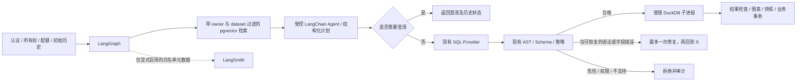

# AI 工作流升级记录

本次在 `codex/agent-rag-upgrade` 本地分支渐进升级，不自动 push、部署或调用付费服务。原始基线为 `a7971cb`，工作树干净。历史验收不能替代本次回归。

## 阶段 1：基线与兼容性

- Python 3.12.14、Node 24.15.0、npm 11.12.1。升级前真实 PostgreSQL 回归 231 passed / 1 skipped；跳过的是需显式启用的真实模型测试。Ruff check / format、Alembic check 通过。当前提交的 Actions `39378633661` 先前已成功，但本次仍重跑本地基线。
- 新依赖：LangGraph 1.2.16、LangChain 1.4.6、langchain-openai 1.7.2、LangSmith 0.14.11、pgvector Python 0.5.1。使用 `StateGraph`、`create_agent`、`ToolStrategy`，不使用弃用的 create_react_agent。
- 实际解析发现 LangGraph SDK 0.4.8 要求 websockets<17，与原锁定 17.2 冲突。只调整这一已有包为 16.1.1，其他现有依赖全部保持原锁；新增的 httpx2 由 LangSmith 引入，需在安装后重跑认证/API 测试。
- 本机 Docker 引擎未运行；已有 PostgreSQL 17.10 精简二进制缺少开发头文件。本机有 Visual Studio C++ 工具链，正在尝试从官方 EDB 17.10 归档补齐开发文件，并编译官方 pgvector 0.8.7。CI/Compose 将使用官方 `pgvector/pgvector:0.8.7-pg17`，不会直接复用 Alpine 数据目录；迁移实例时需逻辑备份/恢复，不能把旧 Alpine 卷挂到 Debian 镜像。
- 安装后重新执行真实 PG 全套：231 passed / 1 skipped；pip check 与新公共 API 导入通过。前端 lint、生产构建以及全部 11 项 Edge E2E 通过并正常退出（1.5 分钟）。本机已使用官方 EDB 开发文件和 VS2022 编译出 pgvector 0.8.7 DLL，尚未安装扩展或升级业务库，留至阶段 4 实际验证。

## 职责与状态边界

权限、数据库行锁、配额和持久化事务仍由普通后端执行。Agent 没有 SQL/Python/Shell/任意文件工具。图状态只存可序列化问题、schema、计划、有界知识引用、SQL、结果和阶段状态；凭据、数据库 Session、服务对象和文件路径只存在受控运行依赖中，不进入图状态。

## 后续阶段

2. StateGraph 与一次有限修复；先保持原 API/事务并验证所有旧测试。
3. create_agent 与有权限检查的结构化工具、澄清、调用/时间/Token 限额。
4. pgvector 迁移、独立 Embedding 接口、明确的 1536 维语义空间。
5. 有界知识导入、更新/删除/重嵌入、检索与前端来源显示。
6. 默认禁用外发，禁止 LangChain 自动追踪原文，LangSmith 仅导出白名单元数据。
7. 固定合成评测集、真实结果评分、基线/升级对照；不据 Fake 指标宣称真实模型提升。
8. 完整回归、迁移回退、Compose、演示与启动说明。

## 阶段 2 验收

`analysis_graph.py` 已实际替换分析路由中的生成/校验/执行控制流；认证、数据集行锁、配额、初始历史、审计、快照和最终事务仍在 `analyses.py`。图为 prepare → generate → validate → execute → check_result；仅通过结构检查后的字段绑定错误可走 repair → validate，最多一次。语法解析失败、危险/不支持 SQL、未知表、超时与资源错误均不修复；旧的无 repair Provider 仍只生成一次。

图状态不包含文件路径、Settings、Session、凭据或结果行；受限查询结果保留在请求运行依赖中。新增 workflow 节点、阶段耗时、校验状态与修复计数，不改变原 timings_ms 的含义；SQL Token 按实际尝试累计，未知保持未知。总工作流默认 90 秒，模型和查询使用剩余时间上限；没有 Checkpointer。外层 tracing_context(enabled=False) 阻止环境中的隐式 LangSmith 追踪上传原文，阶段 6 再添加单独的白名单导出。

实际命令：`ruff check backend` / `ruff format backend`；`LLM_PROVIDER=mock` 与真实测试 PostgreSQL 下 `python -m pytest backend/tests -q -p no:cacheprovider`：**248 passed / 1 skipped**。新增 17 项覆盖一次修复、二次恶意修复拒绝、危险语法/未知表不重试、超时/超大结果终止、总预算和隐式追踪禁用。首轮新增测试将错误代码 unsafe_sql 中的 sql 字样误判为原文泄露，已改为直接断言元数据不含真实 SQL 或问题/结果字段；产品行为无需放宽。

## 官方依据

- [LangGraph Graph API](https://docs.langchain.com/oss/python/langgraph/graph-api)
- [LangChain Agents](https://docs.langchain.com/oss/python/langchain/agents) / [Structured output](https://docs.langchain.com/oss/python/langchain/structured-output)
- [OpenAI Embedding API](https://developers.openai.com/api/docs/guides/embeddings)：text-embedding-3-small 默认 1536 维；聊天凭据与向量凭据必须独立，不假设 DeepSeek 提供 Embedding。
- [pgvector 官方安装与索引说明](https://github.com/pgvector/pgvector)：PG17 支持、0.8.7 Docker 标签、Windows nmake。

## 阶段 3：受控规划 Agent

`analysis_agent.py` 使用真实的 `create_agent` 和 `ToolStrategy(AnalysisPlan, handle_errors=False)`，由外层 StateGraph 的 plan 节点调用。FakePlanningModel 是明确命名的测试/演示模型，但仍通过 LangChain 的实际工具路由执行；真实模式使用独立 ChatOpenAI 适配器复用现有聊天配置，max_retries=0。DeepSeek 关闭 thinking；任意兼容提供商须显式设置 AGENT_NATIVE_TOOLS=true，不能据 Chat API 兼容推断工具支持。

当前工具为 inspect_dataset_schema、get_profile_summary、request_clarification：每次查询重新按 owner + dataset 取数据，只返回列名/类型和有界计数，不返回预览/文件。工具不接受用户身份或任意数据集参数。实际测试发现 LangChain 对完全空 Schema 会跳过 Pydantic 的 extra=forbid，因此 Schema 工具增加只允许 current 的作用域字段，额外 owner_id 被严格拒绝。

Agent 最多 3 次模型、4 次工具调用；保守预留最多 64000 Token（输入 UTF-8 字节上界，包含工具与响应 Schema，加输出预留），每次输出最多 1000 Token，继续受工作流剩余时间约束。真实 usage 单独记录，不将预留上界作为实际用量。无任意 SQL、文件、Python、Shell 或业务写工具。无有效计划、能力配置不符、越权工具、资源限制均失败，不降级 Fake。

关键歧义返回 clarification 状态和具体问题，不生成或执行 SQL；历史可筛选，CSV 导出拒绝。前端沿用现有卡片展示待澄清及如何补充问题。知识工具将在阶段 5 真正连接存储后加入，当前不伪造知识检索结果。

验证：真实 PostgreSQL 全套 **258 passed / 2 skipped**，新增 10 项工具/权限/预算/澄清和原生模型 HTTP 合同测试；跳过项为真实 SQL API 与新增 RUN_LIVE_AGENT 工具调用专项，均未产生付费请求。ESLint、TypeScript/生产构建通过。模型 HTTP 合同使用 MockTransport，不能声称 DeepSeek 原生工具已经实测。
