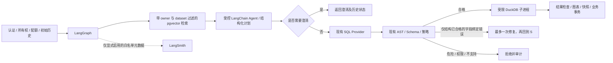

# AI 工作流升级记录

阶段 1–8 在 `codex/agent-rag-upgrade` 本地分支渐进升级，原始基线为 `a7971cb`，当时工作树干净。真实聊天专项和推送前审计见[阶段 9](PHASE9_INTEGRATION.md)；随后按用户授权推送至 `0e7b1c7`，并完成[阶段 10 真实 Embedding/语义 RAG/浏览器验收](PHASE10_EMBEDDING_RAG.md)。阶段 10 改动仅本地提交，未自动推送。历史验收不能替代新提交的回归。

## 阶段 1：基线与兼容性

- Python 3.12.14、Node 24.15.0、npm 11.12.1。升级前真实 PostgreSQL 回归 231 passed / 1 skipped；跳过的是需显式启用的真实模型测试。Ruff check / format、Alembic check 通过。当前提交的 Actions `39378633661` 先前已成功，但本次仍重跑本地基线。
- 新依赖：LangGraph 1.2.16、LangChain 1.4.6、langchain-openai 1.7.2、LangSmith 0.14.11、pgvector Python 0.5.1。使用 `StateGraph`、`create_agent`、`ToolStrategy`，不使用弃用的 create_react_agent。
- 实际解析发现 LangGraph SDK 0.4.8 要求 websockets<17，与原锁定 17.2 冲突。只调整这一已有包为 16.1.1，其他现有依赖全部保持原锁；新增的 httpx2 由 LangSmith 引入，需在安装后重跑认证/API 测试。
- 本机 Docker 引擎未运行；已有 PostgreSQL 17.10 精简二进制缺少开发头文件。本机有 Visual Studio C++ 工具链，已从官方 EDB 17.10 归档补齐开发文件并编译 pgvector 0.8.7。CI 临时数据库使用官方 `pgvector/pgvector:0.8.7-pg17`。Compose 使用单独的 Alpine 构建镜像，保持原 PG17 Alpine 基础与现有卷；若操作者自行换成 Debian 镜像，必须先逻辑备份/恢复，不能盲目复用 Alpine 数据目录。
- 安装后重新执行真实 PG 全套：231 passed / 1 skipped；pip check 与新公共 API 导入通过。前端 lint、生产构建以及全部 11 项 Edge E2E 通过并正常退出（1.5 分钟）。本机已使用官方 EDB 开发文件和 VS2022 编译出 pgvector 0.8.7 DLL，尚未安装扩展或升级业务库，留至阶段 4 实际验证。

## 职责与状态边界

权限、数据库行锁、配额和持久化事务仍由普通后端执行。Agent 没有 SQL/Python/Shell/任意文件工具。图状态只存可序列化问题、schema、计划、有界知识引用、SQL 提案、校验和阶段状态；完整结果保留在 AnalysisRun 中，不进入图状态。凭据、数据库 Session、服务对象和文件路径只存在受控运行依赖中，不进入图状态。

## 约定阶段（执行结果见下方记录）

2. StateGraph 与一次有限修复；先保持原 API/事务并验证所有旧测试。
3. create_agent 与有权限检查的结构化工具、澄清、调用/时间/Token 限额。
4. pgvector 迁移、独立 Embedding 接口、明确的 1536 维语义空间。
5. 有界知识导入、更新/删除/重嵌入、检索与前端来源显示。
6. 默认禁用外发，禁止 LangChain 自动追踪原文，LangSmith 仅导出白名单元数据。
7. 固定合成评测集、真实结果评分、基线/升级对照；不据 Fake 指标宣称真实模型提升。
8. 完整回归、迁移回退、Compose、演示与启动说明。

## 阶段 2 验收

`analysis_graph.py` 已实际替换分析路由中的生成/校验/执行控制流；认证、数据集行锁、配额、初始历史、审计、快照和最终事务仍在 `analyses.py`。图为 prepare → generate → validate → execute → check_result；仅通过结构检查后的字段绑定错误可走 repair → validate，最多一次。语法解析失败、危险/不支持 SQL、未知表、超时与资源错误均不修复；旧的无 repair Provider 仍只生成一次。

图状态不包含文件路径、Settings、Session、凭据或结果行；受限查询结果保留在请求运行依赖中。新增 workflow 节点、阶段耗时、校验状态与修复计数，不改变原 timings_ms 的含义；SQL Token 按实际尝试累计，未知保持未知。总工作流默认 90 秒，模型和查询使用剩余时间上限；没有 Checkpointer。外层 tracing_context(enabled=False) 阻止环境中的隐式 LangSmith 追踪上传原文，阶段 6 再添加单独的白名单导出。

实际命令：`ruff check backend` / `ruff format backend`；`LLM_PROVIDER=mock` 与真实测试 PostgreSQL 下 `python -m pytest backend/tests -q -p no:cacheprovider`：**248 passed / 1 skipped**。新增 17 项覆盖一次修复、二次恶意修复拒绝、危险语法/未知表不重试、超时/超大结果终止、总预算和隐式追踪禁用。首轮新增测试将错误代码 unsafe_sql 中的 sql 字样误判为原文泄露，已改为直接断言元数据不含真实 SQL 或问题/结果字段；产品行为无需放宽。

## 官方依据

- [LangGraph Graph API](https://docs.langchain.com/oss/python/langgraph/graph-api)
- [LangChain Agents](https://docs.langchain.com/oss/python/langchain/agents) / [Structured output](https://docs.langchain.com/oss/python/langchain/structured-output)
- [OpenAI Embedding API](https://developers.openai.com/api/docs/guides/embeddings)：text-embedding-3-small 默认 1536 维；聊天凭据与向量凭据必须独立，不假设 DeepSeek 提供 Embedding。
- [pgvector 官方安装与索引说明](https://github.com/pgvector/pgvector)：PG17 支持、0.8.7 Docker 标签、Windows nmake。

## 阶段 3：受控规划 Agent

`analysis_agent.py` 使用真实的 `create_agent` 和 `ToolStrategy(AnalysisPlan, handle_errors=False)`，由外层 StateGraph 的 plan 节点调用。FakePlanningModel 是明确命名的测试/演示模型，但仍通过 LangChain 的实际工具路由执行；真实模式使用独立 ChatOpenAI 适配器复用现有聊天配置，max_retries=0。DeepSeek 关闭 thinking；任意兼容提供商须显式设置 AGENT_NATIVE_TOOLS=true，不能据 Chat API 兼容推断工具支持。

当前工具为 inspect_dataset_schema、get_profile_summary、request_clarification：每次查询重新按 owner + dataset 取数据，只返回列名/类型和有界计数，不返回预览/文件。工具不接受用户身份或任意数据集参数。实际测试发现 LangChain 对完全空 Schema 会跳过 Pydantic 的 extra=forbid，因此 Schema 工具增加只允许 current 的作用域字段，额外 owner_id 被严格拒绝。

Agent 最多 3 次模型、4 次工具调用；保守预留最多 64000 Token（输入 UTF-8 字节上界，包含工具与响应 Schema，加输出预留），每次输出最多 1000 Token，继续受工作流剩余时间约束。真实 usage 单独记录，不将预留上界作为实际用量。无任意 SQL、文件、Python、Shell 或业务写工具。无有效计划、能力配置不符、越权工具、资源限制均失败，不降级 Fake。

关键歧义返回 clarification 状态和具体问题，不生成或执行 SQL；历史可筛选，CSV 导出拒绝。前端沿用现有卡片展示待澄清及如何补充问题。知识工具将在阶段 5 真正连接存储后加入，当前不伪造知识检索结果。

验证：真实 PostgreSQL 全套 **258 passed / 2 skipped**，新增 10 项工具/权限/预算/澄清和原生模型 HTTP 合同测试；跳过项为真实 SQL API 与新增 RUN_LIVE_AGENT 工具调用专项，均未产生付费请求。ESLint、TypeScript/生产构建通过。模型 HTTP 合同使用 MockTransport，不能声称 DeepSeek 原生工具已经实测。

浏览器阶段回归 **12 passed**，包含原有 11 项和新增“澄清 → 明确追问 → 真实查询”交互，正常退出。

## 阶段 4：pgvector 与独立 Embedding

0006 创建 pgvector、知识文档/分块表、owner/作用域/内容 hash 唯一约束、1536 维向量与 HNSW cosine 索引（m=16 / ef_construction=64）。NULL 作用域约束显式处理三值逻辑，防止非法 personal 范围通过 CHECK。更新/重嵌入使用版本号；状态/失败原因、空间标识和元数据均有独立字段。更换维度需迁移；同维度不同模型/服务也不能混用，空间 ID 包含提供商、模型、维度和服务地址摘要。

`embeddings.py` 明确区分 none、真实 openai/openai_compatible 和 fake。真实默认模型 text-embedding-3-small、1536 维，使用独立 Key 与 /embeddings，验证响应模型、下标、数量、维度、有限数值与非零范数，限制输入批次/响应大小/总超时。Fake 为 lexical-hash-v1，只是可重复的词项哈希，不能宣称真实语义质量。没有配置则明确不可用，不复用聊天 Key，不静默降级。

本机实际安装官方源码编译的 0.8.7；业务库与测试库升级及 Alembic check 通过。新建临时库实际验证 0005 → 0006 → 0005 → 0006，旧平台用户保留；回退移除本阶段表/索引，但有意保留可能被其他应用使用的共享 vector 扩展，不执行 DROP EXTENSION CASCADE。真实 pgvector 存储与 cosine 运算、索引定义已测试。检查约束首版发现 SQL NULL 逻辑遗漏，已在仍为空的新表上修正，未回退业务库。

完整 PostgreSQL 回归 **280 passed / 3 skipped**；新增 NULL 约束回归后向量/Embedding 专项 **23 passed / 1 skipped**，Ruff、迁移 check、Compose config 通过。三个付费专项 SQL/原生工具/Embedding 默认分别跳过。Compose 保持 postgres:17-alpine，通过固定官方源码 commit 编译扩展，运行镜像不含编译工具、构建上下文仅 infra，不发送 .env 或数据。Docker 引擎仍不可用，镜像实际构建/启动留待阶段 8，不记为已通过。

## 阶段 5：知识管理与 RAG

`knowledge.py` 提供当前数据集的结构化知识条目 CRUD、去重、版本更新、重建索引和检索 API。每份知识最多 16000 字符、32768 UTF-8 字节，800 字符分块、100 字符重叠；禁止常见凭据格式，每人最多 100 份文档。远程嵌入前提交 pending 状态，结束后按 owner + 版本加锁检查，避免旧请求覆盖新文档、删除后复活或长时间持有行锁。失败保留明确 error_code，可手动恢复。

检索使用 MATERIALIZED 授权子查询，先限定 owner、当前 dataset 或同 owner personal 作用域、ready 和 embedding_space，再计算 cosine/top-k/阈值。当前以过滤后的精确检索保证隔离与召回；虽然已有 HNSW 索引，暂不声称 ANN 性能收益。外来数据集和用户知识不会进入候选集合。没有配置、无文档、空间不匹配、未命中和检索失败都有不同状态；简单 Schema 查询仍可继续。

图中 retrieve → Agent plan → generate 传递最多 4 个实际来源。Agent 可以自主选择 search_business_knowledge/get_metric_definition；每次工具调用仍检查所有权。模型输出的引用 ID 必须来自真实候选，冲突或未知字段别名请求澄清。知识片段视为不可信上下文，绝不执行其中的 SQL；生成和有限修复后均执行完整 AST 安全检查。Mock 仅支持显式 JSON 字段别名映射，不能冒充业务语义推理。

前端沿用现有组件：数据集中的知识管理支持新增、查看/编辑、删除、重索引与失败状态；分析结果显示阶段、修复/调用数和本次实际使用的文档/分块/相关片段。删除立即影响新检索，已保存分析引用快照随历史保留（默认 30 天）；删除数据集会删除其知识。敏感个人信息仍需导入者预先去敏，凭据格式检测不等于通用 PII 清洗。

验证：PostgreSQL 完整后端 **303 passed / 3 skipped**；Ruff、ESLint、生产构建通过；Edge **13 passed**，包含知识登记、查看、重索引、真实结果 60、实际引用、删除和 390px 无横向溢出。真实聊天、原生工具、Embedding 三个付费专项未启用。浏览器 API 进程显式使用 mock + fake，仅影响测试进程，不修改用户 .env。

## 阶段 6：LangSmith 元数据追踪

独立开关 + Key 才创建 SDK Client；原始 Graph/Agent 自动追踪始终禁用。真实节点和工具调用记录开始/结束时间，完成分析后用有界后台队列导出白名单计数/状态，工具/模型 span 嵌套在 plan 下。Client 二次过滤输入输出和 metadata，并禁止 SDK 自动附加 runtime/env。失败不影响业务结果、历史或审计，队列满明确丢弃。详见 [隐私配置与边界](LANGSMITH.md)。外部云服务未启用，未声称真实看板接收通过。

验证：真实 PostgreSQL 上 Graph、Agent、知识库、业务日志与追踪合计 **66 passed**，Ruff 通过。SDK 最终 batch 请求体、额外环境元数据、输入输出二次拦截、节点/工具父子关系、禁用/无 Key/传输失败/满队列均已检查；没有发送外部请求。

## 阶段 7：固定评估与能力开关对照

`app.evaluate` / `app/evals` 运行 29 道固定合成题，覆盖真实 API、pgvector 与 DuckDB，脚本模型提供明确提案而不充当语义模型。基础模式关闭 Agent/RAG/修复，增强模式启用；实际结果与固定 ground truth 比较，不使用模型自评。报告分别记录生成、执行、结果正确、Recall@4、安全、错误拒绝、调用、已报告 Token、小计缺失、p50/p95 与修复前后结果；金额与真实模型性能未测量。双开关 `--live` + RUN_LIVE_EVAL 才允许真实评估。

实际发现旧 guard 将 AND/OR（SQLGlot 的 Func 子类）误判为危险函数，修复为先识别已有结构白名单，再验证函数白名单；没有新增 SQL 权限。日期多条件现在可执行，新增 AND 中嵌套 getenv 仍拒绝。旧测试全部保留。独立 PostgreSQL 评估/guard 初轮 **53 passed**，新增布尔条件后评分/guard **56 passed**；最终 CLI 两模式 58 次 API 用例执行完成、增强 29/29 规则通过，退出码 0。固定结果见 [报告](evaluation-offline.json)，定义与局限见 [评估说明](EVALUATION.md)。本阶段没有真实外部 API 请求。

## 阶段 8：完整回归、真实容器与交付

最终 PostgreSQL **328 passed / 3 skipped**，Ruff check/format、pip check、Alembic check、ESLint/TypeScript/生产构建通过。原生 Edge **13 passed**；生产 Compose 栈 Edge 再跑同一套 **13 passed**。SQLite 与最终 Linux 镜像计数见完整验收。跳过的真实模型/Embedding 与数据库专项按环境独立标记，没有删旧测试或放宽断言。

最终 SQLite **310 passed / 21 skipped**；Linux 镜像专项含新评分合同 **121 passed / 1 skipped / 1 deselected**（真实 Embedding 默认跳过，独立 PG 评估已在完整 PG 套件运行）。源码冻结后重新构建后端、整栈就绪并重跑 HTTP RAG/账户冒烟，全部 PASS。

Docker 引擎现已可用。Hub 认证超时、ECR 层下载/软件源 EOF 后，使用官方 Docker ECR 镜像和 HTTPS Debian 源完成三个镜像实际构建；未更改全局网络或真实 .env。首次长构建保存旧源码快照，Linux 测试检出缺失 model 校验，随后复用依赖缓存重建并重测通过。最终隔离项目的 PG/backend/frontend healthy、migrate 正常退出，vector 0.8.7 / Alembic 0006。完整 HTTP 冒烟通过真实上传、Agent/Graph、DuckDB 分组、知识入库/删除、RAG 真实引用与 SUM=60、改密/撤销会话。测试栈仅使用独立端口/卷和 Mock/Fake；本次未调用真实 Agent、Embedding、LangSmith 或付费评估。

补充 Agent 请求超时同时受提供商和图剩余时间约束、知识 API 会话/CSRF/额外作用域参数拒绝、控制字符校验、Embedding model 必填。最后接通 LangSmith 官方外部实验上传：--publish-metrics 与开关/Key 同时启用才发送固定用例 ID、评分和实际时间，无问句/SQL/数据；6 项受控 HTTP 合同测试验证隐私与失败边界，没有真正发送云端。架构、配置、实际命令、结果、限制、启动和面试说明整理于 [完整验收](UPGRADE_ACCEPTANCE.md)，[全部文件](UPGRADE_FILES.md) 共 61 项。升级依照要求本地逐阶段提交，不 push；新的 GitHub Actions 尚未运行，不能沿用基线 CI 的结果。
