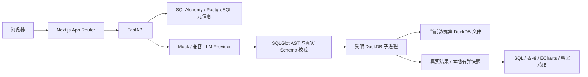

# 架构与学习入口

Next.js 与 FastAPI 分开后，React 状态和 Python 数据执行可独立测试。Next 的同源代理解决浏览器连接问题，不能替代后端安全检查。上传、模型、SQL 和资源限制都集中在 FastAPI。

PostgreSQL 是平台数据库：保存数据集字段画像、问题、SQL、状态和审计。DuckDB 是分析引擎：每份上传数据一个文件，固定表名 `data`。LLM 只接收 Schema 与问题，SQL 执行器只接收经过校验的查询和当前 DuckDB 路径，没有平台连接参数。

## 建议按这条代码路径阅读

1. `backend/app/main.py`：FastAPI 路由、中间件、健康检查；`db.py` 的 Session 依赖随请求关闭，事务由业务函数明确提交。
2. `ingestion.py` → `datasets.py`：先校验和解析，再导入 DuckDB，最后把元信息交给 SQLAlchemy。失败时回滚并清理文件。
3. `providers.py`：Protocol 将模型协议与业务流程隔开。Mock 是明确模板；真实适配器严格检查响应，失败没有假结果。
4. `sql_guard.py` → `execution.py`：提示词指导生成，AST 判断授权范围，真实 Schema 解决未知字段，独立进程负责执行截止时间与隔离配置。
5. `analyses.py`：先写 running 历史与审计，再执行完整分析；成功保存快照，失败保存状态与原因。数据库保存元信息，不保存整份查询行。
6. `presentation.py`：仅从真实行选择图表和生成事实。不能画图时保留表格，不补零、不重排时间、不宣称因果。
7. `frontend/src/components/analysis-panel.tsx`：提问和历史状态；`result-chart.tsx` 的标签与值直接取同一份 SQL 结果，表格与 CSV 也使用这份快照。

## 怎样验证，不只看绿色输出

- `pytest` 用真实 DuckDB 验证结果值，用恶意 SQL 检查拒绝，并验证拒绝后执行器没有被调用。
- 默认数据库测试用临时 SQLite 隔离；显式设置 `TEST_DATABASE_URL` 重跑相同 API 测试，才算验证了真实 PostgreSQL。
- Provider 的 MockTransport 只验证网络合同和异常处理；真实模型专项由 `RUN_LIVE_LLM=1` 单独启用，未运行就标注未验证。
- Playwright 上传文件、等实际响应、核对结果与下载内容、刷新恢复历史；同时检查图表画布、浏览器异常和移动宽度。
- Docker 配置解析不是部署成功。只有镜像构建、容器就绪和 `compose-smoke.py` 都通过，才能宣布容器验收完成。

下一步增强顺序：真实模型验收与 Docker 环境恢复 → 登录/所有权 → 历史筛选与限流/观测 → 有限 SQL 修复 → 确有多步需求时再考虑 LangGraph。当前不需要 Agent 编排来完成单条分析。
