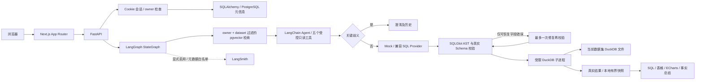

# 架构与学习入口

阶段 14 增加可选的授权后候选融合：PostgreSQL materialized owner/dataset/space CTE → 向量与中文片段词法两路 → RRF → 可选本地 FlashRank → 阈值与 top-k。候选带来源、名次与分数，任何重排错误都不提供未排序知识。生产默认 vector/0.70/none，Ragas 仅在独立评测环境导入。配置、冻结对照及未通过的留出 SQL 见 [RAG 评测](RAG_EVALUATION.md)。

Next.js 与 FastAPI 分开后，React 状态和 Python 数据执行可独立测试。Next 的同源代理解决浏览器连接问题，不能替代后端安全检查。上传、模型、SQL 和资源限制都集中在 FastAPI。

PostgreSQL 是平台数据库：保存账户、会话摘要、数据集归属/字段画像、问题、SQL、状态、审计及授权的业务知识/向量。DuckDB 是分析引擎：每份上传数据一个文件，固定表名 `data`。LLM 接收 Schema、问题和有界计划/业务知识，原始数据行不发送；SQL 执行器只接收经过校验的查询和当前 DuckDB 路径，没有平台连接参数。

完整数据流和代码职责见 [升级记录](AI_UPGRADE.md)。知识输入先验证和分块，经独立 Embedding Provider 生成 1536 维向量。模型、维度和服务空间必须一致；数据库先做 owner/dataset/ready/space 过滤再计算距离。Graph 决定路径，Agent 提供建议；它不能改变认证、配额、审计和 SQL 执行权限。没有 Checkpointer，避免在外部持久化原始图状态。

`auth.py` 的 `current_user` 作为 FastAPI 依赖，读取 Cookie 摘要对应的未过期会话；datasets / analyses 的每条业务查询再约束 `Dataset.owner_id == user.id`。认证回答“你是谁”，所有权回答“你能访问哪份数据”，二者都不能只依赖前端隐藏按钮。分析结果通过数据集继承归属，读文件之前就拒绝非所有者。

使用不透明服务端会话而非 JWT，是因为本项目已有 PostgreSQL，退出可直接撤销行，无需额外维护 JWT 黑名单。HttpOnly Cookie 避免前端持久保存令牌；同源 Next 代理继续转发 Cookie / Set-Cookie。`AuthWorkspace` 管理登录状态，退出或会话失效会卸载 Workbench，清除前一个用户的界面状态。写请求另经 CSRF 头与 Origin 校验。

## 建议按这条代码路径阅读

1. `backend/app/main.py`：FastAPI 路由、中间件、健康检查；`db.py` 的 Session 依赖随请求关闭，事务由业务函数明确提交。
2. `ingestion.py` → `datasets.py`：先校验和解析，再导入 DuckDB，最后把元信息交给 SQLAlchemy。失败时回滚并清理文件。
3. `providers.py`：Protocol 将模型协议与业务流程隔开。Mock 是明确模板；真实适配器严格检查响应，失败没有假结果。
4. `sql_guard.py` → `execution.py`：提示词指导生成，AST 判断授权范围，真实 Schema 解决未知字段，独立进程负责执行截止时间与隔离配置。
5. `analyses.py`：先写 running 历史与审计，再执行完整分析；成功保存快照，失败保存状态与原因。数据库保存元信息，不保存整份查询行。
6. `presentation.py`：仅从真实行选择图表和生成事实。不能画图时保留表格，不补零、不重排时间、不宣称因果。
7. `frontend/src/components/analysis-panel.tsx`：提问和结果状态；`analysis-history.tsx` 单独请求历史元信息，处理搜索、状态筛选、分页、请求过期和重试。`result-chart.tsx` 的标签与值直接取同一份 SQL 结果，表格与 CSV 也使用这份快照。

历史搜索对应 `analyses.py` 的 `history()`：SQLAlchemy 将关键词绑定为参数，并转义 LIKE 通配符；用户输入不会变成 SQL 语法。按 `created_at DESC, id DESC` 排序，即使创建时间相同也有确定顺序。界面一次请求 21 条，仅显示 20 条，用额外一条判断下一页；无需加载大快照或执行全表计数。offset 分页适用于当前小规模元信息检索，跨翻页期间插入/清理记录可能导致位置移动，不保证数据库快照一致性。

## 怎样验证，不只看绿色输出

阶段17的HAVING验证分两步：`sql_guard.py`仍逐节点检查单表语法/函数并执行真实Schema qualify；`having_guard.py`额外确认别名无歧义、条件有界、聚合参数合法、非聚合列属于GROUP BY。安全校验失败仍留在Graph的拒绝分支，不能直接调用DuckDB。见[支持范围与测试](PHASE17_HAVING.md)。

- `pytest` 用真实 DuckDB 验证结果值，用恶意 SQL 检查拒绝，并验证拒绝后执行器没有被调用。
- 默认数据库测试用临时 SQLite 隔离；显式设置 `TEST_DATABASE_URL` 重跑相同 API 测试，才算验证了真实 PostgreSQL。
- Provider 的 MockTransport 只验证网络合同和异常处理；真实模型专项由 `RUN_LIVE_LLM=1` 单独启用，未运行就标注未验证。
- Playwright 上传文件、等实际响应、核对结果与下载内容、刷新恢复历史；同时检查图表画布、浏览器异常和移动宽度。
- Docker 配置解析不是部署成功。只有镜像构建、容器就绪和 `compose-smoke.py` 都通过，才能宣布容器验收完成。

`rate_limits.py` 使用 PostgreSQL 条件 UPSERT 检查计数并递增，避免多个 API 进程分别计数而放大额度。分析配额与创建 running 历史一起提交，上传配额在解析前提交。`observability.py` 生成请求 ID 和固定字段日志，`analyses.py` 保存分段耗时，`providers.py` 仅从响应外层 usage 采集用量；前端以“执行详情”展示，旧历史无指标时保持缺失。

密码管理沿用 PostgreSQL 会话：`confirm_password()` 在凭据操作的行锁内重新确认当前密码和未过期会话，改密与 `accounts.reset_password()` 将哈希更新、全会话删除和审计一起提交。只“改密码哈希”不足以让已登录设备退出；只检查请求开始时的会话又可能在并发重置后继续授权。真实 PG 多连接测试分别验证两种问题，默认 SQLite 回归无法替代它。

登录、owner、密码生命周期、配额与基础观测已实现。升级使用单个受控规划 Agent 和 StateGraph，保留普通后端的安全职责，没有加入多自主 Agent 或持久化 Checkpointer。真实模型、工具和 Embedding 分别验收，不能把离线测试与历史 Actions 当作本次真实模型质量证据。

## 受控追踪与证据回读

`tracing.py` 从实际节点/工具起止时间构造新的元数据字典，经白名单过滤后交给容量 8 的后台队列；不序列化 Graph 状态、模型请求或查询行。来源只保留每条 trace 加盐的哈希。模型标签是固定枚举，陌生名称记 custom，防止任意文本借元数据流出。发送失败不改变分析状态。

`langsmith_acceptance.py` 是显式启用的验收入口：默认只生成本地预览，live 分支从服务器回读实际子树、实验标签与反馈。发送成功和本地 UUID 都不足以证明云端记录存在。阶段 15 的真实浏览器流程读回 14 个 spans，初始语义 no_match 后由指标工具补足知识；它与阶段 14 正式留出评分分开记录，见[真实验收报告](PHASE15_LIVE_ACCEPTANCE.md)。

阶段 16 将 `execution.py` 的启动方式改为 `python -I query_worker.py`，请求/结果通过私有 stdin/stdout JSON 传输，SQL 和文件路径不进入命令参数。原因是 Windows multiprocessing spawn 会重导入父入口：重型评测 CLI 在进入实际查询前已用尽 5 秒。独立 worker 只加载 DuckDB/序列化，不加载 FastAPI、Agent、配置文件或平台数据库。父进程仍限制两槽、含启动的截止时间并 kill/wait 回收，子进程保留只读、128MB、单线程、关闭外部访问等配置。

阶段18候选诊断位于 `retrieval.select_candidates(..., stages)`，只在 `eligible_chunks` 的用户/数据集/空间过滤之后产生；最多5阶段×16候选。`tracing.retrieval_metadata` 将稳定chunk ID替换为每trace加盐哈希，并只允许排名、量化分数与配置摘要。算法与生产默认未变；真实误召回和FlashRank退化见阶段18报告。

阶段19区分初始语义搜索与 `get_metric_definition` 精确名称查找：初始no_match不表示精确工具也没有定义。真实自动发现业务口径失败时按Graph的clarification分支结束，不生成或执行SQL；明确名称工具的独立诊断可以补入合法来源。这既说明读工具可用，也暴露自动口径发现和状态展示仍需改进，不能将工具诊断当作语义召回通过。

阶段21增加 `MetricRegistry`，复用授权知识文档与索引，不新增数据库。它按已登记正式名/别名、定义结构与当前字段确定resolved/ambiguous/not_found/inapplicable/insufficient_evidence；合法来源在规划前优先注入，Agent必须实际选择来源。`AnalysisRun.evidence_guard` 在原SQLGlot/Schema校验之后、DuckDB之前核对聚合AST和必需AND过滤，不依赖提示词保证业务公式。关闭Agent仍不能绕过证据要求。`record_tool`只保存结果分类/数量；完整工具参数仅允许独立合成验收在本地观察。格式与局限见[指标契约](METRIC_DEFINITIONS.md)、[阶段21](PHASE21_METRIC_DISCOVERY.md)。初始向量状态没有被改写，统一来源UI留待后续授权阶段。
