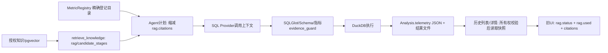

# 阶段23：RAG证据链与历史可解释性

起点 `7d42405211248f5b382eb34745dd72e67f62d880`，分支codex/agent-rag-upgrade，工作区干净。本阶段仅本地提交，不推送或启动阶段24。

## 修改前的数据流



只读调查：现有Analysis.telemetry已保存workflow/rag、计划、校验及错误；详情直接反序列化，无需迁移。旧UI类型不包含candidate_status/evidence，只按rag.used显示来源。candidate_stages只有ID/排名/分数，缩减citations后无法展示未选候选。阶段22used_source_ids在execute返回时直接复制context，未要求登记指标证明且早于结果结构检查。legacy路径缺少完整阶段字段，旧记录不应被当成新证据合同。

## 实施计划与约束

- 复用rag.evidence，添加明确版本及最少的SQL/指标/执行状态；候选、选择、上下文、确认使用各自记录。
- 当次从授权持久化文档读取有界来源快照，统一保存在telemetry，历史读取不重跑检索/目录/模型。历史快照归属分析记录，更新/删除原知识不改写已完成历史；不提供推测的外部链接。
- 前端在现有工作流区域分组展示。没有完整版本的历史只显示实际保留字段及“历史记录未包含该证据”，不猜测采用关系。
- 云端合同只增加固定枚举、有界数量、每trace秘密随机密钥的HMAC来源标识；本轮仅本地确定性/Mock验证，禁止真实聊天、Embedding、LangSmith读写。
- 保留legacy/vector/0.70/none、原SQL门禁、预算、阶段21未知用量护栏。85份历史题集/原始结果/冻结/回执/报告受字节保护，不做质量调参。

以下补充实际实现、测试和审计结果。

## 实际实现与字段合同

修改 `backend/app/analyses.py`、`analysis_graph.py`、`tracing.py`，新增 `evidence_snapshot.py`。复用已有 `workflow.rag.evidence`，增加 `version=1`，不创建新表、重复的API顶层状态或模型调用。

| 当次事实 | 存储字段及来源 | 不代表什么 |
|---|---|---|
| 初始候选 | `rag.candidate_status/candidate_stages`，保留真实检索的阶段、顺序及分数 | 目录补充不是向量命中 |
| 来源渠道 | `evidence.source_origins`：vector_candidate、registered_catalog、agent_tool、unrecorded | 不从标题或相似度猜测来源 |
| 登记适用性 | `evidence.status/eligible_source_ids`，沿用MetricRegistry解析及适用字段检查 | 相似度高不证明定义适用 |
| 计划选择 | `selected_source_ids`，来自当次plan，并核对授权的规划知识 | 被选择不代表已传入SQL调用 |
| SQL上下文 | `context_source_ids`，在实际调用contextual SQL Provider/repair入口时记录 | 不证明远端收到请求、模型注意到或内部采用 |
| 执行后指标确认 | `used_source_ids`，结果结构检查后记录 | 普通Schema/别名查询成功不等于采用登记指标 |
| 校验与执行 | `sql_validation`、`metric_validation`、`execution` | AST通过不等于业务指标正确 |
| 最终决策 | `final_decision`：pending/answer/clarify/reject/error | 执行成功但保存失败仍是错误 |

确认规则为：SQLGlot/Schema approved、原有登记指标evidence_guard approved、DuckDB success、结果结构有效，然后取**适用指标∩计划选择∩传入上下文∩当次授权快照**。任何校验拒绝、超时或坏结果都不确认来源。不增加修复或工具预算，不生成固定SQL，也不放宽AST和执行器限制。旧`rag.used`为兼容保留，语义仍是传入contextual调用，不能代替新确认列表。

例如受控服务实收契约在初始no_match后由目录补充：初始状态保持no_match，目录1条、计划1条、上下文1条；经真实DuckDB及指标校验后确认1条。受控Plain Provider没有contextual方法时即使SQL计算成功，也只能记录计划1条、上下文0条、确认0条。字段别名查询实际SUM(value)=30，计划与上下文各1条，指标校验未进行，确认0条。以上均为离线/Mock证据，不是新真实模型采用率。

### 持久化与权限

`capture_sources`只在当次分析执行时，按owner、当前数据集或本人全局知识范围、ready状态重新核对来源ID；标题、正文和版本取自实际KnowledgeDocument/Chunk，不信任工具返回的正文。最多5个候选阶段×每阶段16条、并集最多96条来源，每片段正文截取800字符。保留当次首次快照，避免中途变更改写已观察内容。模型所选ID不在授权规划知识中时拒绝；不会把越权候选ID放入新快照。

快照、计划、上下文、状态与原有workflow一起写入`Analysis.telemetry` JSON；审计事件只增加版本、状态和数量。详情与列表继续经Dataset.owner_id校验后读取保存的JSON，不调用retriever、目录或Provider。测试在删除知识后禁止这些入口，再读取详情/列表，断言telemetry与原响应完全一致；重新登录后也一致。其他用户详情/知识404、历史空列表，同一用户的其他数据集来源不能进入快照。

旧历史（包括阶段22没有version的evidence）原样返回，不回填或重新评分。UI显示“历史记录未包含该证据”，原rag.status只按“原记录知识状态”解释，不冒充初始向量结果。新版本的缺失列表显示未记录，不补成0或猜测采用。

没有数据库迁移，head仍0006。快照随历史保留/删除，默认结果文件7天、分析/数据集30天；删除原知识不移除历史解释快照，删除所属数据集会清理相关历史。此次最多约96×800字符正文外加元信息，有界但会增加telemetry体积及历史列表响应；尚未进行大规模历史负载基准。

数据库最终提交失败时返回503、删除结果文件，并把本地追踪final_decision标成error。数据库只能保留最初running行、不能持久化完整快照；现有maintenance将超过10分钟的中断分析标为request_interrupted，不能承诺从数据库恢复尚未保存的状态。未增加自动重跑或伪造历史修复。

## 前端行为

新增`analysis-evidence.tsx`，在原有工作流区域分组展示初始检索、目录、适用性、计划、上下文、确认、独立SQL/指标/执行校验和最终决策；来源卡片显示实际快照标题、文档ID、片段及可展开正文，分别显示每阶段状态，不编造链接。相似度明确仅表示向量接近。来源缺失、旧记录、部分字段缺失和执行错误有文字提示，不仅依赖颜色。

`api.ts`增加可选类型，`analysis-workflow.tsx`保留节点/调用计数并接入组件，`globals.css`仅为证据面板增加深色/浅色样式。原图表、导出、历史、账户及分页流程保持现有实现，完整浏览器回归继续覆盖。

新增两项Playwright：一项以真实授权知识记录为基础，用合成响应覆盖13种显示/历史场景（命中、目录补充、无匹配、歧义、不适用、安全拒绝、超时、选择未传递、传递但无指标证明、旧历史、空来源、缺少阶段字段、缺少来源详情）；另一项不拦截分析/历史API，实际Mock/Fake→SQLGlot→DuckDB SUM=30→存储→删除知识→退出/登录→刷新/历史恢复，逐字段核对保存证据。前者是显示合同测试，不宣称13种后端真实调用。可见状态文案、历史操作、390px窄屏无横向溢出及深色实际样式通过，截图已本地检查，仅保存在忽略目录。

## LangSmith本地隐私合同

仅修改本地payload构造与白名单，没有调用云端。导出新增固定枚举、0–96有界数量、候选阶段数量、配置哈希和每阶段最多8个来源HMAC；缺失字段不补造数量。每个trace使用独立32字节秘密随机密钥，HMAC-SHA256截取16个十六进制字符；密钥不导出，不使用公开trace UUID作为秘密，同一trace可关联、不同trace不保持稳定映射。该机制不承诺完全匿名。

root/节点/工具/模型inputs和outputs继续为空；本地原始知识快照、问题、SQL、结果、Schema、用户ID、原始来源ID、私有地址、Cookie、凭据不进入payload。trace随机ID、时间和固定节点名称保留原关联方式。测试对序列化后的整树扫描原正文、问题、SQL和文档/片段ID，检查非法哈希、额外body、陌生状态、布尔数量及越界数量被丢弃；同一运行两次构造的来源标识不同，公开UUID不能重建HMAC。

追踪默认false，隐式LangChain/LangGraph导出继续强制禁用，阶段21未知usage护栏未改。此为本地合同验证通过，**没有阶段23真实云端追踪验收**，不替代任何历史云端记录。

## 最终工程回归

本轮Python3.12.14、Node24.15.0、Next.js16.4.2；本机PostgreSQL17.10/vector0.8.7与独立Compose分别验证。最终代码全量结果如下（不是在早期结果上虚加新增测试）：

| 检查 | 实际结果 | 本地忽略日志 |
|---|---|---|
| 新证据链定向 | 16 passed，10.26s | phase23-target-d.log |
| PostgreSQL全量 | 494 passed / 6既有真实opt-in跳过，194.87s | phase23-postgres-final-full.log |
| SQLite全量 | 471 passed / 29真实服务及PG专用条件跳过，143.88s | phase23-sqlite-final-full.log |
| 普通Playwright最终 | 15 passed / 3真实opt-in skipped，1.2min | phase23-playwright-c.log |
| Ruff check / format | 通过，94个Python文件格式通过 | 命令直接输出 |
| pip check | No broken requirements found | 命令直接输出 |
| 前端lint / TypeScript / 生产build | 全部exit0 | phase23-frontend-lint/typecheck/build.log |
| 最终Compose构建/健康 | 新前后端镜像，三个服务healthy | phase23-docker-build-final/storage、up-storage.log |
| Compose HTTP冒烟 | 健康、CSV上传、Mock SQL、真实DuckDB、Fake知识CRUD/RAG SUM=60、密码/会话撤销通过 | phase23-compose-smoke.log |
| 临时库迁移 | upgrade两次、check、downgrade base、reupgrade/check通过，head0006 | phase23-migrations.log |

全量包含既有RAG、指标解析、SQL安全、Agent权限/预算、超时、查询限制、trace合同等回归。未删除旧测试或把失败改成skip；新UI用例仅新增2项。容器内46份backend/app源码与最终本地逐字节一致；隔离服务实际Mock/Fake、追踪false、三类Key均为空。Compose用既有`infra/compose.test.yml`的0.05合成测试阈值，生产0.70未变；不能用该测试栈成绩证明生产语义召回质量。

### 实际命令与复跑范围

本轮从仓库根设置`PYTHONPATH=backend`后运行（辅助包装器和完整原始日志均在被忽略的data/runtime，不提交运行数据）：

```powershell
.venv/Scripts/python data/runtime/phase23-tests-final.py postgres
.venv/Scripts/python data/runtime/phase23-tests-final.py sqlite
.venv/Scripts/python -m pytest backend/tests/test_evidence_snapshot.py -q --basetemp=data/runtime/pytest23-target-d -p no:cacheprovider
.venv/Scripts/ruff check backend
.venv/Scripts/ruff format --check backend
.venv/Scripts/python -m pip check
npm --prefix frontend run lint
npm --prefix frontend run typecheck
npm --prefix frontend run build
.venv/Scripts/python infra/check-migrations.py --disposable --host 127.0.0.1
. data/runtime/phase23-env.ps1
docker compose build backend migrate frontend
docker compose up -d --wait
.venv/Scripts/python data/runtime/phase23-playwright-c.py
# SMOKE_BASE_URL=http://127.0.0.1:13100/api，SMOKE_REQUIRE_RAG=1
.venv/Scripts/python infra/compose-smoke.py
.venv/Scripts/python infra/audit-git-history.py --details-output data/runtime/phase23-history-audit-final.json
.venv/Scripts/python data/runtime/phase23-final-audit.py
git diff --check
```

postgres包装器仅在进程内把配置连接切换到本机独立datapilot_test，设置TEST_DATABASE_URL/TEST_POSTGRES_URL，不打印凭据；sqlite清除这两项，pytest各自使用唯一basetemp。浏览器包装器只使用.env.example对应的隔离15532数据库与13100前端，所有live开关为0。常规复跑入口为`python -m pytest backend/tests`及`npm --prefix frontend run test:e2e`，需预先按OPERATIONS配置独立离线栈；不要复用已经存在的独占输出文件。

### 失败与修复记录

- 恢复任务时本机PG及Docker引擎未就绪，首轮PG连接失败和Docker构建失败；启动既有本机PG簇及Docker Desktop后复查健康。未重建业务库、删除原卷或修改个人配置。一次PG启动工具路径检查指向不存在路径，改用项目已有便携工具；不影响产品代码。
- 新后端退出/登录测试最初失败1项：conftest快捷Cookie的路径与真实/api Cookie不同；修正测试在重新真实登录前清除快捷Cookie，生产认证未改。此后定向15项通过，新增保存失败边界后最终16项通过。
- 首轮Playwright为14 passed/3 skipped/1 failed，旧数据集删除用例失败：新增上传使共享测试账户触发原有429上传限额。仅让两个新测试使用独立合成账户，未改生产配额或旧测试；之后15/3通过，补充缺失字段和可见文案断言后最终再次15/3通过。原失败日志与错误上下文保留在本地忽略目录。
- 最终只读审计辅助脚本首次引用了错误的Settings属性名，配置检查报AttributeError；改为实际datapilot_langsmith_enabled后，46份容器源码与离线/无Key配置均验证通过。没有为通过检查修改产品设置。
- 较早完整回归493/6、470/29仅覆盖保存失败测试加入前的代码，不能替代上表末次494/6、471/29。

## 真实服务、历史成绩与成本

**阶段23真实聊天请求0、真实Embedding请求0、LangSmith云端写入0/读回0。** 只运行Mock/Fake、受控异常、本机PG/pgvector与DuckDB、浏览器和Docker测试。没有新的语义评测、检索调参、FlashRank或预算变更。

阶段21聊天已知小计17230 Token、Embedding已知344 Token；另有未取得usage的真实失败尝试，完整累计Token和费用仍未知，本阶段没有补全或重跑它们。Mock调用次数不冒充真实API调用或真实Token统计，本轮新增外部Token为0、无新增外部API费用，历史总费用未知。

阶段15旧留出0/2、阶段16冻结留出唯一失败、阶段18误召回3/8、阶段19原4/5及独立诊断、阶段21未知用量、阶段22Fake与9/9目录补充均原样保留。本阶段前端状态完整性不代表真实语义质量通过，9/9目录补充也不是向量召回率100%。生产默认仍`legacy / vector / 0.70 / none`。

## 提交前审计与交付边界

只读历史审计：33提交/542 blobs，当前3类API Key精确匹配0、禁入路径0。模式候选为secret_assignment50、credential_url39、local_path12，与起点历史一致；这些是待分类文本命中，不是50个泄漏密钥。新增于阶段22的示例配置候选为公开演示字段，未发现真实秘密。待提交14文件另查当前Key、非公开数据库密码及私人Embedding主机，匹配0；无.env、日志、数据库、截图或临时文件。有限扫描与人工diff复核不能构成绝对无秘密保证。

起点85份阶段11–22题集、人工复核、冻结、原始结果及历史报告按SHA-256逐字节不变；metric_resolution、sql_guard、config、.env.example、未知usage护栏、依赖锁文件均无修改。没有新依赖、迁移、生产策略切换或云端数据导出。

交付14文件：后端4份执行/追踪实现、新快照测试；前端API类型、工作流、证据组件、局部样式及2项E2E；README、运行说明、隐私说明及本报告。全部检查通过后创建独立本地提交，提交SHA以完成后的git rev-parse HEAD及最终回复为准，不自引用或改写历史。结束时只清理本阶段自己创建的隔离Compose项目与经名称/项目标签核对的两个新卷，不清理原有服务/卷/本机PG。

未解决：真实语义误召回、严格模式泛化质量与真实云端新合同尚未验证；未知历史usage/费用继续阻塞新真实调用；历史快照删除语义与原知识不同；数据库不可用时无法持久化最终证据；大规模历史响应成本未基准化。工程代码具备本地提交条件，**不代表具备真实质量发布条件**。本阶段不推送，无对应新远程CI，不合并、打Tag、创建Release或部署生产；提交后停止，不启动阶段24。
