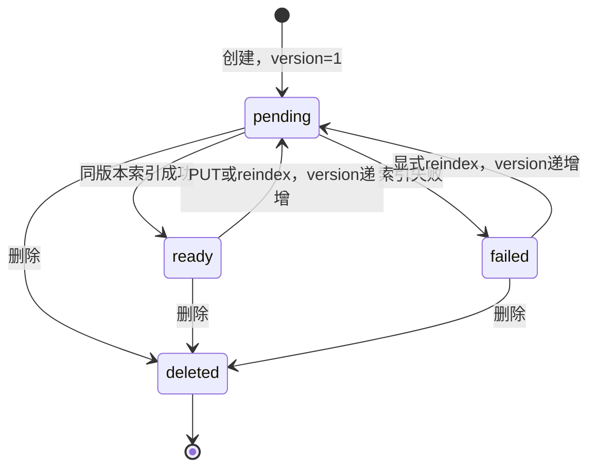

# 阶段26：知识生命周期与执行来源有效性

起始分支`codex/agent-rag-upgrade`、HEAD `39b78a375da35c208db6f6eaff9b6ae6d1b64274`，起始工作区干净。阶段25开发闭环及最终回归通过并本地提交后才开始本阶段。原阶段24/25报告、冻结、失败、账本和旧入口均保留，新证据位于`docs/phase26/`。

## 实际结果与范围

生命周期API验收PASS：首轮24个检查点；第二轮增加重复PUT断言，25个检查点，完全复用首轮真实向量，新增真实HTTP=0。所有索引/检索均使用百炼`text-embedding-v4`1536维实际向量、原FastAPI路由、原切块/索引事务、PostgreSQL/pgvector；每次API响应后用**独立Session/数据库连接**核对文档、chunk、正文、owner、dataset、版本、ready与模型空间。HTTP客户端为本地TestClient调用真实应用，不是绕开处理器手工修改数据库。

仅使用全新合成用户、数据集与短规则；认证身份夹具直接创建，业务知识全部走实际API。没有真实用户数据、聊天模型、LLM裁判或LangSmith请求。故障和并发调度是明确的本地受控注入，不冒充供应商真实宕机。

## 已发现缺陷与最小整改

原应用在规划后若知识更新、删除或重建，仍可能执行旧来源SQL。`test_live_source_guard.py`先复现三种情况：修复前均错误返回201成功，旧执行器被调用；失败日志保留。旧`capture_sources`有意保留历史快照，但不应被误当成新执行的当前授权证明。

新增`evidence_snapshot.validate_live_sources`：对**本次实际SQL上下文来源**重新读取数据库，检查当前owner、dataset或personal作用域、ready、document/chunk关系、版本、正文、Embedding空间/模型及1536维。使用`populate_existing=True`避免ORM身份缓存旧值，稳定顺序锁文档行，锁保持至分析commit。`AnalysisRun.source_guard`在SQL验证与execute前各调用；更新先完成则409 `evidence_source_stale`、0次execute；执行先取锁则更新等待执行事务结束。不会自动更换来源或退回宽松策略。

原SQLGlot、Schema、指标表达式/AND过滤、超时/结果限制未放宽；源过期不可自动修复。历史快照继续供同一所有者读取，不重新检索，也不因此获得新查询授权。新检查不在历史GET时调用，不改写历史分数或正文。

原个人作用域只有数据库支持，没有创建API；为完成真实生命周期边界，增加`POST /api/knowledge`，复用同一`create_document`/索引事务、owner/CSRF、重复检测及配额，`dataset_id=None, scope_key=personal`。原数据集创建路由保持兼容；无新迁移、无新增依赖、不提前接入候选策略。没有通过手工改文档scope绕过验收。

## 状态机与幂等语义



并发旧索引结果仅在版本仍一致时提交；新版已完成则旧尝试409丢弃，不改新版ready结果。pending/failed即使暂有旧chunk，也会被检索SQL的ready过滤排除，不能错误当成有效知识。成功更新后物理旧chunk删除、替换为新chunk；同名重建产生新document/chunk ID。

POST相同内容在同owner/scope下200、duplicate=true、同ID，无重复外部索引；重复DELETE为404但状态仍不存在。重复同正文PUT或reindex保持正文/向量语义，**版本递增，不是版本字段幂等**，如实记录现有设计。删除知识不会删除已经授权的历史快照；历史不是正常检索或新执行缓存。

## 逐项真实API证据

原始记录：[首轮](phase26/lifecycle-01/summary.json)、[第二轮](phase26/lifecycle-02/summary.json)。各编号JSON含真实响应、独立连接看到的所有合成文档和chunk，以及受控故障标志。

| 操作 | 实际验证 |
|---|---|
| 创建及重复导入 | ready/version1/1536维；重复POST同ID，额外HTTP0 |
| 修改正文 | version2；旧chunk ID不存在；新查询仅返回新正文 |
| 更新中查询 | 独立连接看到pending；原chunk暂存但搜索引用为空 |
| 索引失败与恢复 | 本地在发送前抛AppError，API保存failed；不可召回；显式重建恢复ready |
| 错误维度 | 本地受控2维数组被原校验拒绝，failed；不上传不持久化错误向量；恢复用真实缓存 |
| 并发新版本 | 两个实际PUT交错，新版真实索引先完成；旧版真实Embedding结果随后返回被409丢弃，数据库保留新版 |
| 同正文重复PUT | 内容及有效索引一致，version严格递增；独立连接验证 |
| 删除与同名重建 | 所有关联chunk消失，旧源不可召回；重复DELETE404；新同名document ID不同 |
| 删除中重建 | DELETE在重建返回前实际提交，旧重建404且文档/chunk均0，未复活 |
| 个人作用域 | 原API创建None scope，同所有者sibling可见；other用户GET/PUT/DELETE/reindex均404，检索不泄漏 |
| 个人更新与删除 | version2、新正文；删除后不再是有效检索来源 |
| 引用真实性 | 每条引用对照独立连接的document/chunk正文、作用域、ready、维度和模型空间 |

索引/检索没有长期知识结果缓存；本专项仅缓存**模型空间+正文哈希→真实数值向量**来避免重复付费，缓存不存owner/文档ID。更新或删除后的正文向量可以保留供相同合成输入重用，但它不决定授权；实际可见来源始终由数据库当前行和ready条件确定。未授权请求在Embedding之前拒绝。

## 预算、隔离与历史

共享账本仍为固定`data/runtime/phases25-29-live/ledger.sqlite`，没有新建或重置另一轮总额。阶段26局部最多8HTTP/2000输入Token，初始6文本本地估计62、保守预留454；实际**6HTTP/68输入Token**，6次usage与供应商请求ID完整。第二轮新缺失输入0、新真实HTTP0。与阶段25合计：**聊天6/30、5331/20000输入Token；Embedding8/50、449/15000输入Token**；无未知尝试、无裁判或LangSmith。费用与旧阶段21未知消费仍unknown，不推算金额。

本阶段每个新正文通过实际知识索引触发受计量Provider，而重复重建/查询只读复用同正文真实向量。所有失败/竞态均单独标明哪些是“本地受控、0外部HTTP”；成功外部请求的usage不因应用409而删除或改0。预算测试另证实阶段26第9次Embedding在发送前被局部上限拒绝，不能借后续额度。

专用项目`datapilot-phase26`，仅127.0.0.1:15636、独立卷、公开测试配置，不接触原业务5432库。每轮另建并迁移随机临时数据库，结束finally删除，专用基库计数前后相同。原模型Key不进入容器。阶段25旧账本/原159份历史文件保持原样。

生产安全代码在26发生合理演进，因此不能拿当前源码去声称与24冻结源码相同。新增`infra/verify-rag24-archive.py`只读Git中原始`48ca7654…`源码和合成产物，在工作区临时目录离线重算34题余弦、三策略分数与账本，结果verified、0外部请求。原`verify-rag24-results.py`和旧冻结/入口未改；新工具明确核验**历史提交**而不是覆盖旧代码/成绩。

## 命令与工程证据

```powershell
$env:PYTHONPATH='backend'
docker compose -p datapilot-phase26 -f infra/compose.phase26.yml --env-file .env.example up -d --wait
.venv/Scripts/python data/runtime/phase26-test-runner.py prepare
.venv/Scripts/python data/runtime/phase26-test-runner.py postgres target-a <生命周期/权限/引用/预算相关测试>
# RUN_LIVE_PHASE26=1只对本阶段进程；不启用聊天或追踪
.venv/Scripts/python -m app.phase26_acceptance --round lifecycle-01
.venv/Scripts/python -m app.phase26_acceptance --round lifecycle-02
.venv/Scripts/python data/runtime/phase26-test-runner.py postgres final-full
.venv/Scripts/python data/runtime/phase26-test-runner.py sqlite final-full
.venv/Scripts/ruff check backend infra/verify-rag24-archive.py
.venv/Scripts/ruff format --check backend infra/verify-rag24-archive.py
.venv/Scripts/python -m pip check
.venv/Scripts/python infra/verify-rag24-archive.py
# frontend: npm run lint / typecheck / build
```

修复后相关SQLite38项、PG62项通过。新增回归曾误读API错误包装`error`而非原`detail`、未附CSRF的认证探测先获403，均修复测试契约，未改产品错误格式或放宽断言。全部旧测试保留。最终全量/前端、资源清理与审计完成后另存工程回执，不提前宣称尚未结束步骤通过。生产默认未改变，本阶段只本地提交；阶段27须待本阶段准入明确后开始。

最终[工程回执](phase26/engineering-v1.json)：PostgreSQL **557 passed/6 skipped**（221.30s）、SQLite **526 passed/37 skipped**（158.14s），跳过为既有真实服务/PG条件测试，未把失败改跳过。前端lint/typecheck/build、Ruff/format111文件与pip check通过。原0006迁移应用成功，无新迁移；专用API/PG真实生命周期通过，完整应用Compose与Playwright本阶段未重跑，28/29仍需新证据。两轮临时数据库、自建容器/卷均清理，原业务库与共享账本保留。

提交前旧37提交/665 blobs的当前Key精确匹配0、禁入文件0；52个secret_assignment候选比上阶段多的1处为阶段25公开Compose演示密码，其他旧候选不变。新索引另核对私人Key/数据库密码/Embedding主机及公开测试配置。原159份历史文档/fixture哈希不变；历史24原始提交离线验证verified。本地提交与审计通过后满足阶段27开发准入，不代表生产发布批准。
